 

 

I'm a full-stack engineer with strong backend and DevOps depth. I build fintech and real-time systems and own them end to end: architecture, APIs, cloud, CI/CD, observability and production support.

Right now I'm at **AM Industries** in Abu Dhabi, building range-scoring, camera-control and smart-locker software.

 

## `// numbers I'm proud of`

<table>
  <tr>
    <td align="center" width="25%"><h2>$50M+</h2>settled monthly across 20+ banking partners</td>
    <td align="center" width="25%"><h2>8h → &lt;1h</h2>30M+ record export job at ~70% lower cost</td>
    <td align="center" width="25%"><h2>410 → &lt;150ms</h2>live video latency RTSP/H.264 over UDP control</td>
    <td align="center" width="25%"><h2>−50%</h2>AWS spend, with 99.9% uptime</td>
  </tr>
</table>

 

## `// what I've been building`

<table>
  <tr>
    <td width="50%" valign="top">
      <h3>🛰️ LOMAH range scoring</h3>
      Offline scoring platform for 10–20 concurrent lanes: sensors, database records and live scoring over Socket.IO.  
      <code>Node.js</code> · <code>Socket.IO</code> · <code>Sensors</code>
    </td>
    <td width="50%" valign="top">
      <h3>🎥 Android camera control</h3>
      The company's first remote camera-control app: multiple RTSP/H.264 feeds via LibVLC with joystick control over UDP.  
      <code>Kotlin</code> · <code>Jetpack Compose</code> · <code>LibVLC</code>
    </td>
  </tr>
  <tr>
    <td width="50%" valign="top">
      <h3>🔐 Armory smart locker</h3>
      Go server tying face verification, admin approval and ESP32 item sensors together, with live status over SSE.  
      <code>Go</code> · <code>SSE</code> · <code>ESP32</code>
    </td>
    <td width="50%" valign="top">
      <h3>🔭 Overseer</h3>
      Observability platform on Grafana, Loki and Tempo, plus an agent that triages alerts and suggests likely root causes.  
      <code>Grafana</code> · <code>Loki</code> · <code>Vector</code> · <code>LLM</code>
    </td>
  </tr>
  <tr>
    <td width="50%" valign="top">
      <h3><a href="https://github.com/roshan-ican/codemap">🗺️ codemap</a> open source</h3>
      Local, browser-based code map for Git repos: see how files connect, review branch changes and build AI-ready context.  
      <code>Go</code> · <code>Svelte</code>
    </td>
    <td width="50%" valign="top">
      <h3>🤝 Binder in development</h3>
      AI partner matching for manufacturers and businesses: embeds company profiles, scores fit and notifies both sides.  
      <code>Go</code> · <code>React Native</code> · <code>AI</code>
    </td>
  </tr>
  <tr>
    <td width="50%" valign="top">
      <h3><a href="https://apps.apple.com/in/app/eleven11-app/id6755789328">💡 Eleven Eleven</a> live on the App Store</h3>
      Cross-platform IoT app for ESP32 smart lamps.  
      <code>Flutter</code> · <code>Supabase</code> · <code>ESP32</code>
    </td>
    <td width="50%" valign="top">
      <h3><a href="https://w-agent-eta.vercel.app/">💬 WhatsApp Agent</a> live</h3>
      AI agent that answers questions and runs everyday tasks inside WhatsApp.  
      <code>AI Agent</code> · <code>WhatsApp</code>
    </td>
  </tr>
</table>

 

## `// stack`

  
   
  

 

## `// github, live`

 

## `// currently`

- 🔧 Writing more **Go**: concurrent, real-time services
- 📱 Shipping **React Native** apps (Binder, Buy or Wait)
- 🧊 Exploring **Three.js** and AI agent orchestration
- 🏆 Top 3.3% in Google's Agentic AI Hackathon 2025, and a Google Cloud Agentic AI Day finalist

 

**Have a system to build? [Say hello →](mailto:roshansahani535@gmail.com?subject=Hello%20Roshan)**

Built to scale. Built to survive production.

